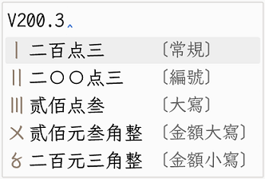
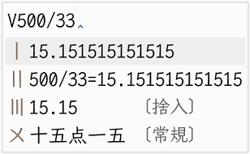
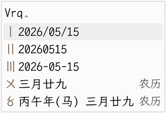
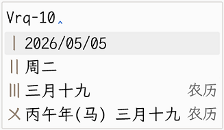

# 雜然

## 简介：

自然码双拼+魔然字词/拆字+万象模型

## 大致说明
本方案仅基于本人对一次输入即正确结果需求所改    
主要的输入方式是 字词挂接、句中辅整句
主要核心为：
- `pseudo_moran.lua` : 负责输出字词表和智能整句词库
- `moran_pin.lua` : 固定常用词和自定义用户词
- `moran_reorder_filter.lua` : 使字词表和pin词使用的词频正常映射到智能词库内的词频上  

以魔然方案的挂接打法为主，为引用较高整句准确率的万象词库(需要基于不含自造词的纯净词库与模型)。所以分别使用两个翻译器：一个是无自造词的“固词翻译器”，另一个是支持词频动态调整的“frequency翻译器”。以上与原有的字词翻译器“fixed”一同由 `pseudo_moran.lua` 处理，以提升候选词首次命中的概率。

> [!TIP]
> 本方案大部分功能与魔然一致，可以在魔然说明书中找到对应说明
> 魔然官网：[魔然官网](https://moran.rimeinn.org/zh-Hans/book/usage/features.html)

本方案内kagiroi是缩减版，只保留`romaji`功能

## 快符
本方案快符引导为后置触发，快符引导为`/`键

| 输出 | 输入 | 记忆点      |
| ---- | ---- | ----------- |
| ·    | j/   | j_间隔号    |
| _    | x/   | x_下划线    |
| ……   | s/   | s_省略号    |
| .    | d/   | d_点        |
| ——   | h/   | h_横线      |
| '    | a/   | 无序_冒号   |
| “    | q/   | 无序_左冒号 |
| ”    | w/   | 无序_右冒号 |
| 『   | u/   | 无序_角引号 |
| 』   | i/   | 无序_角引号 |
##  混合V键
| 功能       | 引导                                                    | 演示                                 |
| ---------- | ------------------------------------------------------- | ------------------------------------ |
| 大写数字   | `V`+任意数字                                            |          |
| 简易计算器 | `V`+算式                                                |      |
| 日期输入   | `V`+`sj`→时间<br>`V`+`rq`→日期<br>`V`+`xq`or`week`→星期 |            |
| 日期偏移   | `rq`+`±`+`任意整数`                                     |  |

## 快捷键
| 功能               | 引导                                   |
| ------------------ | -------------------------------------- |
| `Ctrl+s`           | 用字标准                               |
| `Ctrl+u`           | 拼音提示                               |
| `Ctrl+g`           | 字集过滤切换                           |
| `Ctrl+Shift+G`     | 固词模式                               |
| `Ctrl+b`           | 额外comment提示（拆字、翻译）          |
| `Ctrl+i`           | 切分轮换                               |
| `Ctrl+i`or`Ctrl+o` | 快速取回辅助码                         |
| `Ctrl+q`           | 候选列表注入emoji                      |
| `Ctrl+Shift+space` | 切换输入法（`zaran`与`kagiroi`间切换） |
| `ok`               | `kagiroi`反查                          |
| `olf`              | 两分与笔画反查                         |

## 移除功能或模块
### 移除kagiroi相关的部件
#### 第一步：删除文件与文件夹

| 路径                                             | 说明                                                                                                                                                                                           |
| ------------------------------------------------ | ---------------------------------------------------------------------------------------------------------------------------------------------------------------------------------------------- |
| `./kagiroi_romaji.schema.yaml`                   | 罗马字布局子方案                                                                                                                                                                               |
| `./kagiroi_romaji.dict.yaml`                     | 罗马字→假名映射表                                                                                                                                                                              |
| `./kagiroi_kanji.schema.yaml`                    | 汉字反查子方案                                                                                                                                                                                 |
| `./kagiroi_kanji.dict.yaml`                      | 汉字反查词典                                                                                                                                                                                   |
| `./kagiroi.schema.yaml`                          | 主方案（引擎流水线入口）                                                                                                                                                                       |
| `./kagiroi.dict.yaml`                            | 主词典（`import_tables` 聚合）                                                                                                                                                                 |
| `./kagiroi.yaml`                                 | 共享配置（字母表、标点、键位）                                                                                                                                                                 |
| `./kagiroi.custom.yaml`                          | 方案外观补丁（`color_scheme: Raspberry`）                                                                                                                                                      |
| `./lua/kagiroi/`                                 | Lua 组件目录（`kagiroi.lua`、`kagiroi_kana_speller.lua`、`kagiroi_translator.lua`、`kagiroi_viterbi.lua`、`kagiroi_aux_filter.lua`、`lru.lua`、`priority_queue.lua`、`segmenter.lua`、`dic/`） |
| `./lua/kagiroi_matrix_temp.bin`                  | 连接矩阵运行期缓存（约 38 MB，可删除，删除后首次部署会重建）                                                                                                                                   |
| `./other_dicts/kagiroi_dicts/`                   | 词典源数据（`kagiroi.mozc`、`kagiroi.nico`、`kagiroi.manual`）                                                                                                                                 |
| `./opencc/kagiroi_h2k.json`、`kagiroi_h2k.txt`   | 平假名→片假名转换配置                                                                                                                                                                          |
| `./opencc/kagiroi_h2kh.json`、`kagiroi_k2kh.txt` | 平假名→半角片假名转换配置                                                                                                                                                                      |
| `./ico/kagiroi.ico`                              | 方案图标                                                                                                                                                                                       |
| `./etc/kagiroi.md`                               | 上游端到端实现笔记（仅供查阅，可保留）                                                                                                                                                         |
| `./kagiroi.userdb/`                              | kagiroi 用户词典与词频（删除即放弃该方案的打字记录）                                                                                                                                           |
| `./sync/<installation_id>/kagiroi.userdb.txt`    | 同步目录内的 kagiroi 用户词备份                                                                                                                                                                |

#### 第二步：修改配置文件

**`default.yaml`** —— 从方案列表中移除：

```yaml
schema_list:
  - schema: zaran               # 自然码
  # - schema: kagiroi           # romaji   ← 删除或注释本行
```

**`default.custom.yaml`** —— 同样从方案列表补丁中移除：

```yaml
patch:
  schema_list:
    - {schema: zaran}
    # - {schema: kagiroi}       ← 删除或注释本行
```

**`zaran.custom.yaml`** —— 移除以下 5 处引擎接线与 1 处 `kagiroi` 配置段：

```yaml
# schema/dependencies/+ 下移除该行
# - kagiroi

# engine/processors/@before 2: lua_processor@*kagiroi/kagiroi_kana_speller  # 需要在key_binder后面
# engine/segmentors/@before 3: affix_segmentor@kagiroi                      # 需要在abc_segmentor前面
# engine/translators/+ 下的该行
# - lua_translator@*kagiroi/kagiroi_translator
# engine/filters/@before 1: lua_filter@*kagiroi/kagiroi_aux_filter@reverse  # kagiroi辅筛

# recognizer/patterns/+ 下移除 kagiroi 入口
# kagiroi: '^(?:ok|\xE3\x81[\x81-\xBF]|\xE3\x82[\x80-\x9F]|\xE3\x83\xBC)(?:\xE3\x81[\x81-\xBF]|\xE3\x82[\x80-\x9F]|\xE3\x83\xBC|[a-z\-;`])*$'

# 文件末尾的 kagiroi 配置整段移除
# kagiroi:
#   prefix: ok
#   tips: 〔カギロイ〕
#   tag: kagiroi
#   layout: romaji
#   speller:
#     __include: kagiroi:/alphabet/3_dan
#   translator:
#     input_mapping:
#       - xform/^([^`]*)n$/$1ん$/
#   gikun:    # 训读
#     enable: true
#     delimiter: ";"
```


## 平台支持：

- 小狼毫:[weasel](https://github.com/rime/weasel)
- 同文：[trime](https://github.com/osfans/trime)

## 感谢：
魔然：[rime-moran](https://moran.rimeinn.org/)  
万象词库：[RIME-LMDG](https://github.com/amzxyz/RIME-LMDG)  
kagiroi：[rime-kagiroi](https://github.com/rimeinn/rime-kagiroi)  
成对符号：[rime-paired-punct](https://github.com/pfeiwu/rime-paired-punct)   
Rime agent：[agent-skills](https://github.com/rimeinn/agent-skills)   
感谢 @XiHanQWQ 关于lua方面的解惑与修改  
